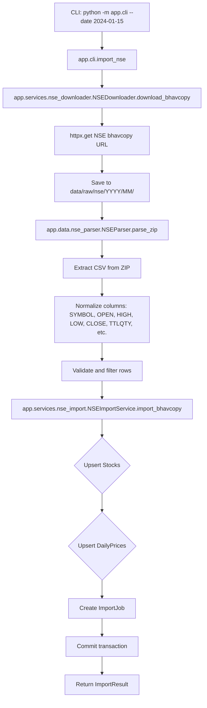
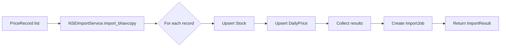

# Import Flow

## NSE Bhavcopy Import Flow



## Import Service Flow



## Data Transformation

```
NSE CSV Columns → Internal Models
- SYMBOL → stock.symbol
- OPEN → open_price
- HIGH → high_price
- LOW → low_price
- CLOSE → close_price
- TTLQTY → volume
- TTLTRDVAL → value
- TOTALTRADES → trades
- DELIVQTY → delivery_qty
- DELIVPER → delivery_percent
```

## Error Handling

| Error | Handling |
|-------|----------|
| Network failure | Retry with backoff |
| Invalid ZIP | Log and skip |
| Missing columns | Raise ValueError |
| Duplicate data | Upsert (no error) |
| DB constraint | Rollback transaction |
