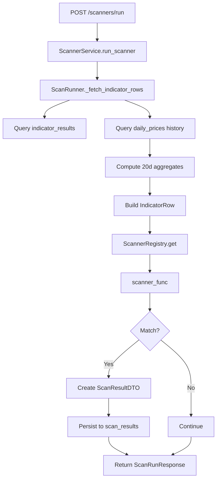

# Scanner Flow

## Scanner Execution Flow



## Scanner Registry Pattern

Scanners are registered using a decorator pattern:

```python
@ScannerRegistry.register("volume_2x_average")
def volume_2x_average(current, previous):
    # Scanner logic
    return matched, score, metrics
```

## Scanner Function Signature

```python
ScannerFunc = Callable[
    [IndicatorRow, IndicatorRow | None],
    tuple[bool, float, dict[str, Any]]
]
```

- `current`: Current day's IndicatorRow with pre-computed aggregates
- `previous`: Previous day's IndicatorRow (None if insufficient history)
- Returns: `(matched, score, metrics)`

## 20-Day Aggregate Computation

ScanRunner computes these aggregates per stock before running scanners:

| Aggregate | Field | Description |
|-----------|-------|-------------|
| Average Volume | `avg_volume_20d` | Mean volume over last 20 sessions |
| Max Volume | `max_volume_20d` | Maximum volume over last 20 sessions |
| Average Delivery | `avg_delivery_20d` | Mean delivery% over last 20 sessions |
| Max Delivery | `max_delivery_20d` | Maximum delivery% over last 20 sessions |
| Max High | `max_high_20d` | Maximum high price over last 20 sessions |

## Scanner Categories

| Category | Count | Examples |
|----------|-------|----------|
| Trend | 8 | ema_bullish_crossover, golden_cross, supertrend_bullish |
| Momentum | 8 | rsi_oversold, macd_bullish, stochastic_overbought |
| Volatility | 3 | bollinger_band_squeeze, atr_high_volatility |
| Volume | 4 | volume_2x_average, volume_breakout, obv_rising |
| Delivery | 4 | delivery_above_60, delivery_breakout |
| Combined | 3 | high_volume_high_delivery, accumulation |
| Trend Strength | 2 | strong_trend_adx, weak_trend_adx |
| VWAP | 2 | vwap_bullish, vwap_bearish |
