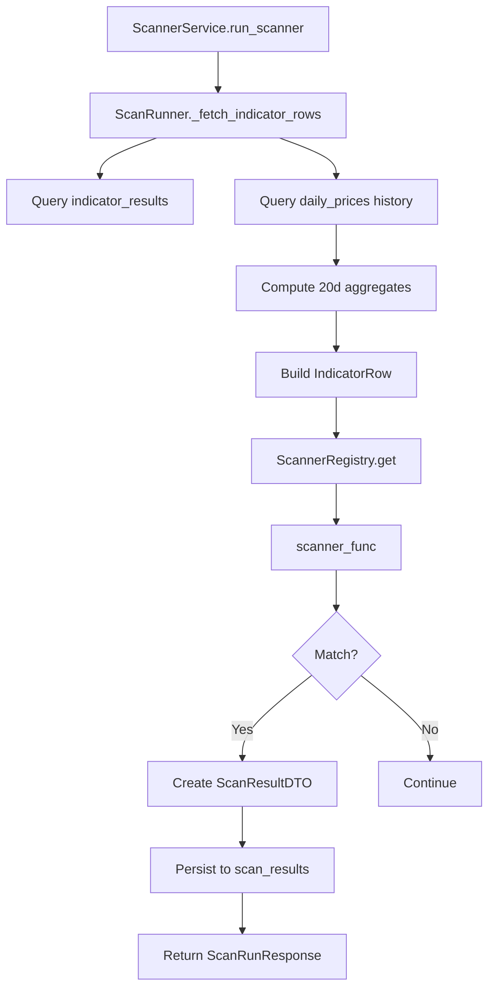

# Scanner Engine

## Overview
Executes trading scanners against indicator data to identify stock patterns.

## Components

### ScannerRegistry
Decorator-based registry for scanner functions.

```python
@ScannerRegistry.register("volume_2x_average")
def volume_2x_average(current, previous):
    return matched, score, metrics
```

### ScanRunner
Orchestrates scanner execution.

**Key Methods:**
- `_fetch_indicator_rows()`: Fetches indicator data + 20d aggregates
- `run_scanner(scan_code)`: Executes single scanner
- `run_all()`: Executes all active scanners

### ScannerService
High-level service for scanner operations.

**Key Methods:**
- `run_scanner(scan_code)`: Validates and runs scanner
- `run_all()`: Runs all active scanners
- `persist_results(results)`: Saves results to database

## Execution Flow



## Scanner Function Signature

```python
ScannerFunc = Callable[
    [IndicatorRow, IndicatorRow | None],
    tuple[bool, float, dict[str, Any]]
]
```

## 20-Day Aggregates

| Aggregate | Field | Description |
|-----------|-------|-------------|
| Average Volume | `avg_volume_20d` | Mean volume over last 20 sessions |
| Max Volume | `max_volume_20d` | Maximum volume over last 20 sessions |
| Average Delivery | `avg_delivery_20d` | Mean delivery% over last 20 sessions |
| Max Delivery | `max_delivery_20d` | Maximum delivery% over last 20 sessions |
| Max High | `max_high_20d` | Maximum high price over last 20 sessions |

## Performance
- Sub-2 minute execution for 500 stocks
- Efficient bulk queries
- Minimal memory footprint
