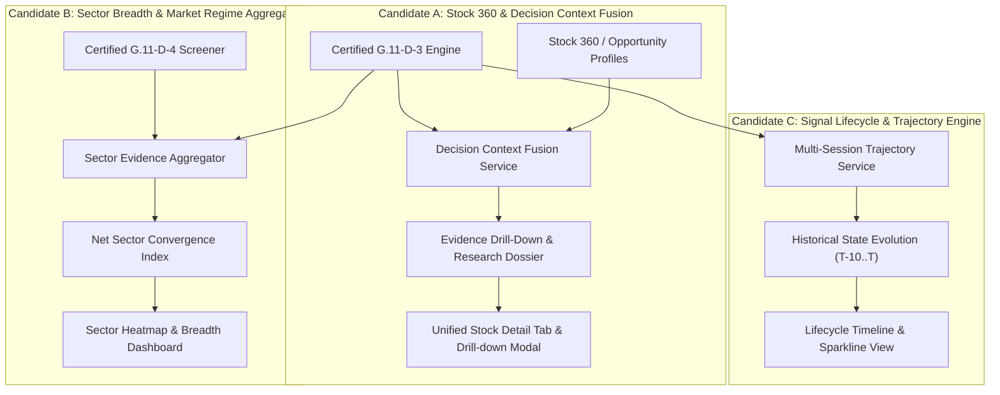

# G.11-D-5 Architecture & Specification

- **Milestone:** G.11-D-5 — Stock 360 & Decision Context Fusion Layer
- **Document Status:** ARCHITECTURE READY — SPECIFICATION COMPLETE
- **Base Commit:** `6664cb0e6de4f27a9b07d315087b1114b7429b50` (G.11-D-4 Certified)
- **Parent Commit:** `1cab27cb8ea8bf055b7b63dd069c14baced18933` (G.11-D-3 Certified)
- **Branch:** `checkpoint/sprint19-20-20260822`
- **Database Migration Head:** `f1b9c8d7e6a5` (Unchanged)

---

## 1. Current Certified Baseline

The AIStockScanner repository is currently certified through milestone **G.11-D-4**:

- **G.11-D-1** (`5e062f1`): Deterministic atomic change detection across 7 independent domains (`PRICE`, `VOLUME`, `DELIVERY`, `TECHNICAL`, `DERIVATIVES`, `FUNDAMENTALS`, `INSTITUTIONAL`) between session $T$ and baseline session $T-w$ with significance scoring and threshold filtering.
- **G.11-D-2** (`529cca7`): Cross-domain deterministic relationship synthesis (confirmations, divergences, contradictions, context) with strict semantic alignment to D-1 price significance ($\ge 2.0\%$).
- **G.11-D-3** (`1cab27c`): Deterministic 8-state classification, corrected directional convergence ratio, pattern lifecycle progression ($T$ vs $T-1$), deterministic watch items and limitations, and an isolated, fail-closed AI narrative explanation layer.
- **G.11-D-4** (`6664cb0`): Multi-stock universe screening layer (`WhatChangedScreeningService`) supporting index universes (`NIFTY_50`, `NIFTY_NEXT_50`, `NIFTY_MIDCAP_100`, `NIFTY_BANK`), `FNO`, and user `WATCHLIST`, with bounded async concurrency (max 5 workers with isolated sessions), Point-in-Time (PIT) universe resolution, deterministic convergence ranking, and full HTMX/REST UI integration.

**Consolidated Verification Baseline:**
- 217 / 217 automated tests passing across D-1, D-2, D-3, and D-4.
- 14 / 14 browser matrix verification checks passing.
- Ruff linter: clean.
- `git diff --check`: clean.
- Alembic head: `f1b9c8d7e6a5`.
- Protected D-1, D-2, D-3 files: 0 modifications.

---

## 2. D-4 Capability Inventory

Milestone G.11-D-4 provides a multi-stock opportunity screening engine:

1. **Inputs:**
   - Predefined or custom universes: `NIFTY_50`, `NIFTY_NEXT_50`, `NIFTY_MIDCAP_100`, `NIFTY_BANK`, `FNO`, `WATCHLIST` (up to 100 symbols soft-capped), or custom CSV list (up to 100 symbols validated).
   - Temporal parameters: `as_of_date` (PIT evaluation date) and `comparison_window` (1–30 trading sessions).
   - Filter criteria: `overall_states`, `directional_biases`, `min_convergence_ratio`, `min_supporting_domains`, `require_pit_safe`.
   - Presentation parameters: `include_non_matched`, `max_results`.

2. **Evaluations:**
   - Resolves universe symbols deterministically (including historical index constituents and F&O availability `available_at <= as_of`).
   - Fans out isolated per-symbol evaluations via `asyncio.Semaphore(5)` using independent `AsyncSession` instances.
   - Invokes D-3 `interpret()` with `include_ai_narrative=False` (hard-enforced AI exclusion).
   - Applies Boolean filter logic (AND/OR).
   - Sorts matched results deterministically by `convergence_ratio DESC`, tie-broken by `symbol ASC` (`None` sorted last).
   - Truncates matched results to `max_results` after sorting.

3. **Outputs:**
   - Summary statistics (`total_universe_size`, `matched_count`, `no_match_count`, `no_data_count`, `error_count`).
   - List of `SymbolScreeningResult`: symbol, company name, outcome status, matched flag, evaluation date, comparison date, overall state, directional bias, convergence ratio, supporting/conflicting/context domain lists, PIT safety, and error details.

4. **Invariants Enforced:**
   - 100% deterministic (zero randomness, zero non-deterministic ordering).
   - Zero AI involvement at the screening layer.
   - Zero database mutations (stateless on-demand execution).
   - Strict PIT safety (no future lookahead).

---

## 3. D-4 → D-5 Gap Analysis

While D-4 successfully identifies *which* stocks match specific evidence criteria across a universe, the analytical workflow encounters major gaps immediately after screening:

### Gap 1: Absence of Candidate Explanation & Evidence Drill-Down
A user viewing the D-4 screening table sees summary badges (`BULLISH_EVIDENCE_SUPPORTED`, `80% convergence`, `[PRICE, VOLUME, TECHNICAL]`). However, there is no mechanism to inspect:
- *What specific atomic changes occurred?* (e.g. Did price cross a 200 EMA? Did delivery volume surge by 300%?)
- *What cross-domain relationships were formed?* (e.g. Price/Volume confirmation vs Delivery divergence).
- *What conflicting evidence was detected?* (e.g. Insider selling or negative derivative OI build-up).
- *What is the pattern lifecycle?* (Is this setup emerging, strengthening, or already fading?)
- *What are the active limitations and watch items?*

### Gap 2: Disconnect from the Single-Stock Research Workflow (`stock_detail.html`)
In the D-4 results table, clicking a symbol navigates to `/stocks/{symbol}` (`stock_detail.html`). However:
- `stock_detail.html` still displays the legacy Stage 2.6.5 Phase F static score (`components/stock_intelligence.html`).
- It has **zero** awareness of G.11-D dynamic What-Changed change events, cross-domain synthesis relationships, or D-3 interpretation states.
- The user experiences an analytical dead-end: the screener surfaces dynamic multi-domain consensus, but the detail page shows legacy, static multi-factor ratings.

### Gap 3: Disconnect between Dynamic Evidence and Strategic Decision Context (Stock 360 & Opportunity Profiles)
AIStockScanner features a sophisticated 10-dimensional `Stock360Service` and 5 specialized opportunity profiles (`INVESTMENT_QUALITY`, `QUALITY_PULLBACK`, `BREAKOUT`, `SWING`, `BTST_READINESS`).
- Currently, these profiles operate solely on static snapshots and technical filters.
- They lack dynamic confirmation: an opportunity candidate might score high on `BREAKOUT` while D-3 detects `CONTRADICTORY_EVIDENCE_HIGH_RISK` or `BEARISH_DIVERGENCE`.
- Conversely, a strong D-3 `BULLISH_EVIDENCE_SUPPORTED` candidate needs to be contextualized: is it an actionable swing setup, a pullback in an uptrend, or a high-risk corporate event?

### Gap Categorization:
- **Strongly Supported by Existing Architecture:**
  - Single-stock candidate explanation & evidence drill-down (D-1, D-2, D-3 engines are fully certified).
  - Integration into `stock_detail.html` via HTMX partials.
  - Decision context fusion linking D-3 interpretation with `Stock360Snapshot` and Opportunity Profiles.
- **Plausible but Requires Additional Design:**
  - Multi-session historical trajectory tracking (evaluating D-3 across $T-1, T-2, \dots, T-10$).
  - Sector-wide evidence breadth aggregation (aggregating D-3 across all sector constituents).
- **Out of Scope / Premature:**
  - Automated trading execution, order routing, or broker connectivity.
  - Backtesting and paper trading execution engines.
  - Machine learning predictive models or return forecasting.

---

## 4. Candidate Architectures

Three neutral, technically grounded candidates were evaluated.



---

### Candidate A: Stock 360 & Decision Context Fusion Layer (Evidence Drill-Down & Research Dossier)

- **Purpose:** Vertically complete the research workflow from screener to stock dossier. Fuses dynamic D-3 interpretation, D-2 cross-domain relationships, and D-1 atomic change events with the 10-dimensional `Stock360Snapshot` and Opportunity Profiles into a unified, actionable research dossier.
- **User Problem Solved:** Eliminates the analytical dead-end after screening. Allows users to click on any screened candidate to immediately inspect all confirming/conflicting evidence, verify pattern lifecycle, review watch items and limitations, examine strategic setup compatibility (Breakout, Swing, Pullback), and read an on-demand AI narrative.
- **Primary Components:**
  - `StockDecisionContextFusionService`: Orchestrates D-3 interpretation and Stock 360 snapshot.
  - Opportunity Qualification Evaluator: Verifies if dynamic evidence supports or contradicts active opportunity profiles.
  - REST Endpoints: `GET /api/v1/stocks/{symbol}/decision-context`, `GET /api/v1/stocks/{symbol}/decision-context/drill-down`.
  - UI Components: Dedicated "Intelligence & Evidence" section in `stock_detail.html` and a modal/drawer drill-down from the D-4 screener table.
- **Architectural Trade-Offs:**
  - *Pros:* Direct continuation of user workflow; zero database scaling risk (single-stock on-demand); completely stateless; unifies fragmented legacy Phase F intelligence with G.11-D; high user value.
  - *Cons:* Focuses on single-stock depth rather than market-wide macro aggregation.

---

### Candidate B: Sector Breadth & Market Evidence Consensus Aggregator

- **Purpose:** Horizontally aggregate D-3 interpreted evidence states across all NSE sectors and major indices to measure market-wide and sector-specific evidence breadth (e.g. % Bullish vs % Bearish vs % Conflicted per sector).
- **User Problem Solved:** Answers macro questions: *"Is market momentum supported by broad sector participation, or concentrated in a single heavy-weight? Which sectors show genuine institutional convergence?"*
- **Primary Components:**
  - `SectorEvidenceAggregatorService`: Reuses D-4 screening engine over all sectors.
  - Breadth Metric Calculator: Computes net sector convergence and conflict ratios.
  - REST Endpoint: `GET /api/v1/market-intelligence/sectors/evidence`.
  - UI Component: Sector evidence heatmap and breadth dashboard.
- **Architectural Trade-Offs:**
  - *Pros:* Provides macro regime context; identifies sector rotations early.
  - *Cons:* Computationally intensive across hundreds of stocks unless run as an EOD batch job; does not resolve the single-stock drill-down gap.

---

### Candidate C: Signal Lifecycle & Trajectory Engine (Multi-Session Evolution)

- **Purpose:** Track the historical evolution of a stock's interpreted evidence state across $N$ prior trading sessions (e.g. $T-10$ to $T$), charting state transitions (`NEUTRAL` → `EMERGING` → `STRENGTHENING` → `PEAKED`), convergence trend, and conflict resolution.
- **User Problem Solved:** D-3 only observes $T$ vs $T-1$. Users cannot determine whether an evidence state is newly triggered (early entry) or has persisted for 10 sessions (mature/extended).
- **Primary Components:**
  - `SignalTrajectoryService`: Evaluates historical D-3 snapshots over multiple dates.
  - Trajectory Analyzer: Identifies state transition velocity and persistence.
  - REST Endpoint: `GET /api/v1/stocks/{symbol}/signal-trajectory`.
  - UI Component: Timeline/sparkline visualizer on stock detail.
- **Architectural Trade-Offs:**
  - *Pros:* Solves temporal maturity questions; provides valuable trend-evolution signals.
  - *Cons:* High computational overhead if un-cached (requires $N$ sequential D-3 evaluations per stock); design would benefit significantly from persistent caching or pre-computed EOD runs.

---

## 5. Proposed D-5 Architecture: Stock 360 & Decision Context Fusion Layer

Based on explicit repository evidence, user workflow continuity, and architectural maturity, **Candidate A** is the proposed architecture for milestone **G.11-D-5**.

### Why Candidate A?
1. **Solves the Immediate Workflow Disconnect:** D-4 delivers multi-stock screening results, but the application provides no way for users to inspect the underlying evidence or understand *why* a stock matched. Candidate A bridges this gap directly.
2. **Replaces Legacy Static Scoring:** It replaces the isolated Phase F static score on `stock_detail.html` with certified G.11-D dynamic intelligence.
3. **Zero Concurrency & Scalability Risk:** Candidate A operates single-stock on-demand ($O(1)$ stock queries), avoiding the high database loads of macro sector sweeps.
4. **Stateless & Migration-Free:** Fully achievable without any schema modifications, keeping the database stable and clean.
5. **Enforces AI Containment:** AI narrative generation remains strictly on-demand for single-stock deep dives, preventing API rate-limit exhaustion.

---

## 6. Component Boundaries

```
[ G.11-D-4 Screener UI / Table ]
             │
             │ (Click "Inspect Evidence" or Symbol)
             ▼
[ StockDecisionContextFusionService ]
   │
   ├──> [ WhatChangedInterpretationService (D-3) ]
   │       │
   │       ├──> [ WhatChangedSynthesisService (D-2) ]
   │       │       └──> [ WhatChangedService (D-1) ]
   │       │
   │       └──> [ InterpretationNarrativeService (AI / Fallback) ] (Optional)
   │
   ├──> [ Stock360Service (10-Dimensional Snapshot) ]
   │
   └──> [ Opportunity Profile Matcher (Breakout, Pullback, Swing, Investment, BTST) ]
             │
             ▼
[ StockDecisionContextRead (Unified Dossier) ]
             │
   ┌─────────┴────────────────────────┐
   ▼                                  ▼
[ REST API /api/v1/stocks/... ]     [ HTMX UI Components ]
                                      ├── Screener Evidence Modal
                                      └── Stock Detail "Intelligence & Evidence" Tab
```

### Components Involved:
1. **`StockDecisionContextFusionService` (NEW)**:
   - Orchestrator located at `app/services/stock_decision_context_service.py`.
   - Consumes certified D-3 `WhatChangedInterpretationService` and existing `Stock360Service`.
   - Performs deterministic cross-matching between D-3 evidence states and Stock360 opportunity profiles.
2. **Schemas (NEW)**:
   - `app/schemas/stock_decision_context.py`: Defines `StockDecisionContextRead`, `EvidenceDrillDown`, `ProfileEvidenceAlignment`.
3. **API Routes (NEW/EXTENDED)**:
   - REST route in `app/api/routes/stocks.py`: `GET /api/v1/stocks/{symbol}/decision-context`.
   - HTML routes in `app/api/routes/stocks_pages.py`:
     - `GET /stocks/{symbol}/decision-context`: HTML partial for `stock_detail.html`.
     - `GET /stocks/{symbol}/evidence-modal`: HTML modal partial for D-4 screener drill-down.
4. **Templates (NEW/MODIFIED)**:
   - `app/templates/components/stock_decision_dossier.html` (NEW): Full evidence dossier card.
   - `app/templates/components/evidence_drill_down_modal.html` (NEW): Screener drill-down modal.
   - `app/templates/stock_detail.html` (MODIFIED): Integration of the dossier partial.
   - `app/templates/components/what_changed_screening_results.html` (MODIFIED): Action button to trigger evidence modal.

---

## 7. Data Flow

1. **Invocation**:
   - Case A: User clicks "Inspect" on a screened symbol in D-4 results.
   - Case B: User loads `/stocks/{symbol}` or switches to the "Evidence & Intelligence" tab.
   - Case C: API client queries `GET /api/v1/stocks/{symbol}/decision-context`.
2. **Service Execution**:
   - `StockDecisionContextFusionService.get_decision_context(symbol, evaluation_date, comparison_window, include_ai_narrative)`:
     - Fetches D-3 `StockIntelligenceInterpretation` (which contains D-2 synthesis and D-1 event tree).
     - Fetches `Stock360Snapshot` via `Stock360Service`.
     - Cross-references D-3 evidence against active opportunity profiles:
       - *Example (Breakout)*: If stock matches `BREAKOUT` technical criteria, does D-3 report `BULLISH_EVIDENCE_SUPPORTED` with volume/delivery confirmation, or does it flag a `DIVERGENCE`?
       - *Example (Contradiction Veto)*: If D-3 flags `CONTRADICTORY_EVIDENCE_HIGH_RISK` or heavy insider selling, flags an explicit `EVIDENCE_CONTRADICTION_WARNING`.
3. **Response Assembly**:
   - Unifies dynamic interpretation, supporting/conflicting domain details, watch items, limitations, opportunity alignment, and optional AI explanation into `StockDecisionContextRead`.

---

## 8. Input Contract

### `DecisionContextRequest`
```python
class DecisionContextRequest(BaseModel):
    model_config = ConfigDict(frozen=True)

    symbol: str = Field(..., description="Stock symbol (case-insensitive)")
    evaluation_date: date | None = Field(default=None, description="PIT evaluation date")
    as_of_date: date | None = Field(default=None, description="PIT observation cutoff")
    comparison_window: int = Field(default=1, ge=1, le=30, description="D-1/D-2 comparison window in sessions")
    include_ai_narrative: bool = Field(default=False, description="Enable bounded AI narrative")
```

---

## 9. Output Contract

### `StockDecisionContextRead`
```python
class ProfileEvidenceAlignment(BaseModel):
    model_config = ConfigDict(frozen=True)
    profile_type: str  # e.g., "BREAKOUT", "QUALITY_PULLBACK", "SWING"
    technical_match: bool
    evidence_status: str  # "CONFIRMED", "CONTRADICTED", "NEUTRAL", "INSUFFICIENT_DATA"
    alignment_reason: str
    veto_triggered: bool

class StockDecisionContextRead(BaseModel):
    model_config = ConfigDict(frozen=True)

    symbol: str
    company_name: str | None
    sector_name: str | None
    evaluation_date: date
    comparison_date: date
    comparison_window_sessions: int
    pit_safe: bool

    # Dynamic Evidence (from D-3)
    overall_state: OverallState
    directional_bias: DirectionalBias
    convergence_ratio: float | None
    supporting_domains: list[str]
    conflicting_domains: list[str]
    context_domains: list[str]
    missing_domains: list[str]

    # Detailed Drill-Down Evidence (from D-3/D-2/D-1)
    primary_evidence: list[EvidenceItem]
    supporting_evidence: list[EvidenceItem]
    conflicting_evidence: list[EvidenceItem]
    context_evidence: list[EvidenceItem]
    pattern_lifecycle_records: list[PatternLifecycleRecord]
    watch_items: list[WatchItem]
    limitations: list[Limitation]

    # Opportunity Profile Alignment
    profile_alignments: list[ProfileEvidenceAlignment]
    active_vetoes: list[str]

    # Narrative
    narrative: NarrativeResult | None
    fallback_narrative: str

    generated_at: datetime
```

---

## 10. REST API Contract

### Endpoint 1: Complete Decision Context Dossier
- **Method:** `GET`
- **Path:** `/api/v1/stocks/{symbol}/decision-context`
- **Auth:** Standard API Bearer token (`stocks:read`)
- **Query Params:**
  - `as_of_date: date | None` (default: latest)
  - `comparison_window: int` (default: 1, range: 1–30)
  - `include_ai: bool` (default: false)
- **Response:** `200 OK` → `StockDecisionContextRead`
- **Errors:**
  - `404 Not Found`: Symbol does not exist.
  - `422 Unprocessable Entity`: Invalid date or window parameters.
- **PIT Behavior:** All underlying queries strictly enforce `date <= as_of_date`.
- **Determinism:** All fields deterministic except optional narrative text (which is validated fail-closed).

---

## 11. Browser / UI Contract

### 1. Stock Detail Integration (`/stocks/{symbol}`)
- **Location:** Replaces the legacy Phase F card (`components/stock_intelligence.html`) with `components/stock_decision_dossier.html`.
- **Display Structure:**
  - **Hero Header:** Overall Evidence State badge, Directional Bias badge, Convergence Progress Bar, Pattern Lifecycle chip (`EMERGING`, `STRENGTHENING`, etc.).
  - **Evidence Breakdown Tabs/Columns:**
    - *Confirming Evidence:* Green cards detailing D-1 metrics and D-2 domain relationships.
    - *Conflicting Signals:* Warning cards highlighting divergences (e.g. Price up but Volume/Delivery down).
    - *Contextual Developments:* Bulk deals, corporate announcements, shareholding notes.
  - **Strategy Alignment Panel:** Badges showing alignment with Breakout, Swing, and Pullback profiles.
  - **Watch Items & Limitations:** Transparent lists of what data is missing or what confirmation is required.
  - **AI Narrative Accordion:** Collapsible narrative with AI/Fallback provenance and validation badge.

### 2. Screener Evidence Drill-Down (`/stocks/screening/what-changed`)
- **Interaction:** Each row in the D-4 screener table gets an "Inspect Evidence" button.
- **HTMX Call:** `hx-get="/stocks/{symbol}/evidence-modal?as_of_date=..." hx-target="#evidenceModalContainer" hx-swap="innerHTML"`.
- **UI Element:** Bootstrap modal displaying the evidence drill-down without navigating away from the screener.

---

## 12. Point-in-Time Semantics

- Every component in D-5 receives and propagates `as_of_date` and `evaluation_date`.
- `StockDecisionContextFusionService` passes `as_of_date` to D-3, which passes it to D-2, D-1, and `Stock360Service`.
- No queries may reference `trade_date > as_of_date` or `available_at > as_of_date`.
- Verified by automated temporal regression tests comparing live vs historical replays.

---

## 13. Determinism Requirements

- The entire evidence fusion and profile alignment logic is 100% deterministic.
- Given the same database state and `as_of_date`, identical JSON and HTML structures are produced every time.
- Zero floating-point rounding ambiguities; sorting orders are explicitly defined with tie-breakers.

---

## 14. AI Boundary

- **Strict Containment:** Generative AI is NEVER invoked during multi-stock screening or batch evaluation.
- **On-Demand Only:** AI narrative generation is only invoked when `include_ai=True` on a single-stock decision context request.
- **Zero Control:** AI never decides states, convergence, profile alignments, vetoes, or rankings.
- **Fail-Closed Validation:** All AI narratives pass through D-3's numeric and factual validation rules; if validation fails, the deterministic fallback narrative is rendered.

---

## 15. Error and Partial-Failure Semantics

- **Stock Not Found:** Returns standard `404 Not Found` (JSON) or clean error flash (UI).
- **Missing Domain Data:** If a domain is unpopulated (e.g., stock is not in F&O), D-5 records `UNAVAILABLE` in `missing_domains` and adds a deterministic `Limitation`. It NEVER crashes or invents zero values.
- **AI Failure:** If the AI provider times out or errors, D-5 smoothly falls back to the deterministic template narrative (`source="fallback"`), returning HTTP 200.

---

## 16. Concurrency Model

- D-5 is a single-stock research layer ($O(1)$ stock per request).
- Requests execute asynchronously within the caller's `AsyncSession`.
- No shared mutable state across coroutines.
- No background workers or multithreaded locks required.

---

## 17. Database / Persistence Decision

- **Persistence Requirement:** NONE.
- **Decision:** D-5 remains 100% stateless and on-demand.
- **Rationale:**
  - Dynamic change detection depends on user-selected `comparison_window` (1 to 30 days) and `as_of_date`. Pre-computing and storing all combinations would cause combinatorial storage bloat.
  - On-demand execution for a single stock completes in < 80ms.
  - Current Alembic head `f1b9c8d7e6a5` remains untouched.

---

## 18. Security / Authorization

- Standard application authorization: requires authenticated user with `stocks:read` browser/API permission.
- All HTML endpoints enforce CSRF token validation via `app.auth.csrf`.
- Input validation: symbols sanitized, dates parsed with ISO-8601 validation, comparison window clamped to `[1, 30]`.

---

## 19. Testing Strategy

1. **Unit Tests:**
   - Test `StockDecisionContextFusionService` orchestration and profile alignment logic with mock D-3 and Stock360 inputs.
   - Verify deterministic handling of conflicting evidence and vetoes.
2. **API Route Tests:**
   - Verify `GET /api/v1/stocks/{symbol}/decision-context` returns valid JSON matching `StockDecisionContextRead`.
   - Test parameter validation (invalid symbol, out-of-range window).
3. **HTML / HTMX Route Tests:**
   - Verify `/stocks/{symbol}/decision-context` returns 200 HTML fragment.
   - Verify `/stocks/{symbol}/evidence-modal` renders modal markup with CSRF headers.
4. **Point-in-Time (PIT) Tests:**
   - Execute historical replay at known past dates and verify future data is strictly excluded.
5. **Regression Protection:**
   - Run full 217-test consolidated G.11 regression suite to guarantee zero regression on D-1, D-2, D-3, and D-4.

---

## 20. Acceptance Criteria

1. **AC-1 (Service Orchestration):** `StockDecisionContextFusionService` successfully fuses D-3 interpretation, D-2 relationships, D-1 events, and Stock360 data without modifying underlying D-1/D-2/D-3 outputs.
2. **AC-2 (Profile Alignment):** Strategic alignment and contradiction vetoes are correctly computed for all 5 opportunity profiles deterministically.
3. **AC-3 (REST API):** `GET /api/v1/stocks/{symbol}/decision-context` returns `StockDecisionContextRead` with HTTP 200 for valid stocks.
4. **AC-4 (Stock Detail UI):** `stock_detail.html` embeds the dynamic decision dossier, replacing the legacy Phase F static panel.
5. **AC-5 (Screener Drill-Down UI):** D-4 screener table allows clicking "Inspect Evidence" to view the complete evidence drill-down modal without page reloads.
6. **AC-6 (PIT Safety):** Invariant verified: evaluating at date $T$ excludes all data from date $> T$.
7. **AC-7 (AI Safety):** AI narrative is off by default; when enabled, fail-closed validation is enforced.
8. **AC-8 (Zero Regression):** All 217 existing G.11 tests pass with zero modifications to protected files.
9. **AC-9 (No DB Migrations):** Database schema and Alembic head remain unchanged.

---

## 21. Protected Existing Components

The following certified files must remain strictly protected and unmodified during D-5:
- **D-1:** `app/services/what_changed_service.py`, `app/schemas/what_changed.py`, `tests/test_what_changed_g11d1.py`.
- **D-2:** `app/services/what_changed_synthesis_service.py`, `app/services/what_changed_synthesis_config.py`, `app/schemas/what_changed_synthesis.py`, `tests/test_what_changed_synthesis_g11d2.py`.
- **D-3:** `app/services/what_changed_interpretation_service.py`, `app/services/what_changed_interpretation_config.py`, `app/schemas/what_changed_interpretation.py`, `app/ai/interpretation_narrative_service.py`, `tests/test_what_changed_interpretation_g11d3.py`.
- **D-4:** `app/services/what_changed_screening_service.py`, `app/services/what_changed_screening_config.py`, `app/schemas/what_changed_screening.py`, `tests/test_what_changed_screening_g11d4.py`.

---

## 22. Explicit Non-Goals

- No automated trade execution or order routing.
- No database persistence or historical snapshot tables for screening runs.
- No macro sector-wide aggregation (reserved for Candidate B / future milestone).
- No multi-session historical trajectory chart generation (reserved for Candidate C / future milestone).
- No modification of certified D-1/D-2/D-3/D-4 algorithms.

---

## 23. Future Milestone Dependencies

- **G.11-D-6 (Sector Breadth & Market Consensus):** Will build on D-4 and D-5 to aggregate evidence across sectors.
- **Milestone 4 (Alerts & Notifications):** Can consume D-5 decision context to trigger alerts on high-conviction confirmations.
- **Stage 3 (Paper Trading):** Can consume D-5 opportunity profile alignments for simulated strategy entry/exit evaluation.

---

## 24. Open Questions

1. **AI Narrative Display in Screener Modal:** Should the on-demand drill-down modal from the D-4 screener support triggering an AI narrative via a separate button, or should it remain 100% deterministic template-only?
2. **Opportunity Profile Weights:** Should the contradiction veto rules for opportunity profiles be configurable via settings or remain strictly hardcoded in configuration constants?

---

**ARCHITECTURE SPECIFICATION COMPLETE — READY FOR ARCHITECTURE REVIEW**
