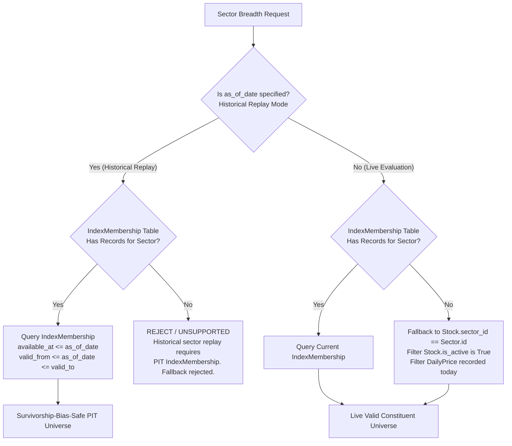
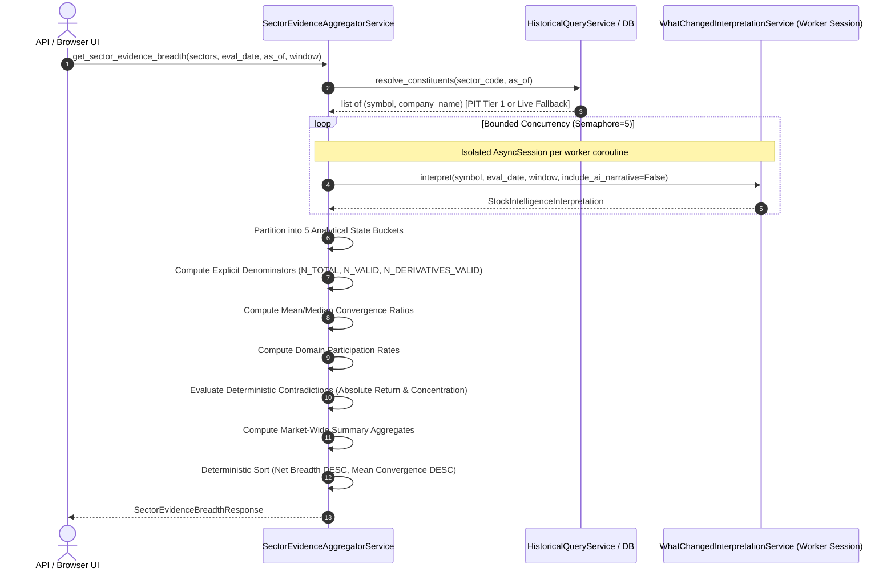
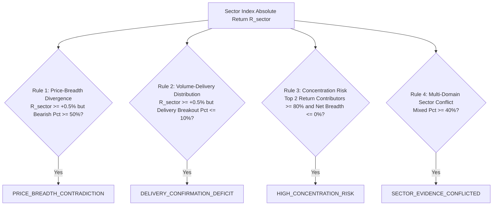

# G.11-D-6 Architecture & Technical Specification
## Sector Breadth & Market Evidence Consensus Aggregator

- **Milestone:** G.11-D-6 — Sector Breadth & Market Evidence Consensus Aggregator
- **Document Status:** FORMAL SPECIFICATION — SPEC-R1 ARCHITECTURE REVISION
- **Base Commit:** `fd49ff980746a9123bac85a2dd13ab28bf9c6e67` (G.11-D-5 Certified)
- **Parent Commit:** `6664cb0e6de4f27a9b07d315087b1114b7429b50` (G.11-D-4 Certified)
- **Branch:** `checkpoint/sprint19-20-20260822`
- **Database Migration Head:** `f1b9c8d7e6a5` (Unchanged — 0 migrations)

---

## SPEC-R1 CHANGELOG

The following architectural corrections were applied pursuant to independent architecture review (SPEC-R1):
1. **Tier-2 PIT Survivorship Bias Resolution (Corrections #1 & #2):** Eliminated reliance on current-state `Stock.is_active` for historical PIT eligibility. Clarified that `Stock.sector_id` is NOT historically versioned; historical sector replay is supported strictly via Tier 1 (`IndexMembership`), while `Stock.sector_id` fallback is restricted exclusively to live evaluations (`as_of_date is None`).
2. **Deterministic Concentration Risk Formula (Correction #3):** Resolved conflicting wording ("single outlier" vs "top 2 >= 80%"). Replaced with ONE explicit, reproducible equal-weight constituent return contribution proxy formula with rigorous edge-case guards ($N < 5$, $|S_{\text{pos}}| < 2$, zero/negative denominators).
3. **5-State Analytical Distribution Model (Correction #4):** Extracted `INSUFFICIENT_EVIDENCE` from the Neutral bucket into its own distinct 5th analytical state bucket, preventing artificial inflation of neutral breadth.
4. **Explicit Canonical Denominators (Corrections #4, #5 & #11):** Established a unified denominator table defining $N_{\text{TOTAL\_ELIGIBLE}}$, $N_{\text{NO\_DATA}}$, $N_{\text{ERROR}}$, $N_{\text{ANALYTICAL\_VALID}}$, $N_{\text{INSUFFICIENT\_EVIDENCE}}$, and explicit derivatives counters ($N_{\text{DERIVATIVES\_ELIGIBLE}}$, $N_{\text{DERIVATIVES\_VALID}}$, $N_{\text{DERIVATIVES\_ACTIVE}}$).
5. **Absolute Sector Return for Contradictions (Correction #6):** Replaced "vs Nifty Benchmark" references with "Sector Index Absolute Return" ($R_{\text{sector}} \ge +0.5\%$), avoiding undeclared relative return calculations in v1.
6. **Accurate NSE Sector Universe Terminology (Correction #7):** Standardized terminology to "17 supported NSE sector/thematic index universes configured by AIStockScanner".
7. **List-Based Protected File Integrity (Correction #8):** Replaced static count references with explicit list-based integrity enforcement against Section 32.
8. **Stable D6 -> D4 Interface Boundary (Correction #9):** Decoupled D-6 from private D-4 methods (`_evaluate_symbol`). Defined a stable public constituent evaluation contract invoking certified D-3 `WhatChangedInterpretationService.interpret()` with isolated worker sessions, free from D-4 screening truncation/filtering.
9. **UI / API Schema Alignment (Correction #10):** Added market-wide aggregate fields (`sectors_bullish_pct`, `sectors_bearish_pct`, `sectors_neutral_pct`, `market_mean_convergence_ratio`) to `SectorEvidenceBreadthResponse` with explicit denominators over confirmed sectors.
10. **Target-Based Performance Assertions (Correction #12):** Recast latency expectations as "Initial performance targets" subject to empirical QA validation rather than guaranteed claims.
11. **Expanded 9-Scenario PIT Test Matrix (Corrections #13 & #14):** Expanded the test matrix to 9 comprehensive PIT scenarios (PIT-01 through PIT-09) and augmented test requirements for concentration, denominators, and boundaries.
12. **Enforceable Acceptance Criteria (Correction #15):** Updated Section 31 to 15 strict, verifiable criteria reflecting all SPEC-R1 corrections.

---

## 1. Purpose

The purpose of **G.11-D-6** is to establish a deterministic **Sector Breadth & Market Evidence Consensus Aggregator** for AIStockScanner.

While milestones G.11-D-1 through G.11-D-3 established atomic change detection, cross-domain synthesis, and stock intelligence interpretation for single securities, G.11-D-4 provided multi-stock screening across arbitrary universes, and G.11-D-5 fused dynamic evidence with Stock 360 dossiers, the platform currently lacks **macro sectoral evidence synthesis**.

G.11-D-6 aggregates certified G.11-D-3 interpretations horizontally across the 17 supported NSE sector/thematic index universes configured by AIStockScanner. It transforms constituent-level evidence (price action, volume expansion, delivery breakouts, derivatives participation, and institutional announcements) into transparent, verifiable sector-level evidence breadth metrics, directional consensus distributions, domain participation rates, and structural contradiction flags.

---

## 2. Problem Statement

Individual equity signals frequently mislead traders and researchers when evaluated in isolation from their macro and sectoral context:

1. **False Breakout Risk (Lack of Sector Participation):** A stock breaking out on above-average volume often fails if 80% of its sector peers are experiencing distribution or heavy call writing resistance. Currently, researchers viewing a screened candidate in D-4 or D-5 cannot see whether the sector as a whole confirms the move.
2. **Concealed Sector Contradiction:** A sector index (e.g. `NIFTY_AUTO`) may advance +1.2% due to a massive rally in a single mega-cap constituent, while the remaining constituents exhibit bearish divergence or delivery distribution. Traditional price-weighted index tracking masks this internal divergence.
3. **Macro Evidence Asymmetry:** Existing platform sector tools (`SectorIntelligence` in `app/services/sector_intelligence.py`) operate strictly on index closing prices and moving averages (SMA20/50/200). They have **zero** constituent-level awareness of delivery percentages, option chain shifts, or cross-domain confirmations.
4. **Analytical Fragmentation:** Users must manually run D-4 screens across multiple watchlist sectors or review individual stock dossiers one by one to infer whether an industry group is moving together.

G.11-D-6 solves these problems by providing an automated, deterministic aggregation layer that computes sector-wide evidence consensus without inventing subjective scores or predictive return models.

---

## 3. Relationship to D1–D5

G.11-D-6 is an orchestration and aggregation layer situated strictly above G.11-D-4 and G.11-D-3:

```
[ G.11-D-6: Sector Breadth & Market Evidence Consensus Aggregator ]
                     │
                     ▼
[ G.11-D-4: Concurrency & Universe Patterns (Bounded Concurrency Semaphore) ]
                     │
                     ▼
[ G.11-D-3: WhatChangedInterpretationService (Deterministic Classification) ]
                     │
                     ▼
[ G.11-D-2: WhatChangedSynthesisService (Cross-Domain Relationships) ]
                     │
                     ▼
[ G.11-D-1: WhatChangedService (7-Domain Atomic Change Detection) ]
```

- **Reuses Concurrency Patterns from D-4:** Employs bounded async semaphore control (`SCREENING_MAX_WORKERS = 5`) and isolated `AsyncSession` ownership per worker, without calling private D-4 methods.
- **Consumes D-3 Invariants:** Directly digests certified `StockIntelligenceInterpretation` fields (`overall_state`, `directional_bias`, `convergence.convergence_ratio`, `supporting_evidence`, `conflicting_evidence`).
- **Supports D-5 Workflow:** D-5 research dossiers can link directly to the sector breadth context of the stock's primary industry.
- **Strict Non-Duplication:** G.11-D-6 performs **zero** pairwise raw metric calculations, **zero** cross-domain relationship rule evaluation, and **zero** pattern lifecycle derivations. It operates strictly as an aggregation and statistical synthesis engine.

---

## 4. Scope

The scope of G.11-D-6 encompasses:

1. **Canonical Sector Universe Catalog:** Supporting 17 supported NSE sector/thematic index universes configured by AIStockScanner.
2. **Point-in-Time Sector Constituent Resolution:** Authoritative Tier 1 resolution via `IndexMembership` (survivorship-bias safe) with live-only fallback to `Stock.sector_id` active trading presence.
3. **Stateless Aggregation Engine:** `SectorEvidenceAggregatorService` executing bounded constituent evaluations.
4. **Discrete Sector Evidence Metrics:**
   - Directional consensus distribution (% Bullish, % Bearish, % Mixed, % Neutral).
   - Distinct tracking of insufficient evidence (% Insufficient Evidence).
   - Mean and median directional convergence ratios.
   - Net directional breadth percentage (Bullish % − Bearish %).
   - Domain-level participation breadth (% Volume breakout, % Delivery confirmation, % Derivative expansion).
5. **Deterministic Sector Contradiction Engine:** Rule-based flags for price-breadth divergence, delivery distribution, concentration risk, and multi-domain conflict.
6. **REST API Endpoint:** Authenticated `GET /api/v1/market-intelligence/sectors/evidence-breadth`.
7. **Interactive HTMX UI Component:** Sector Evidence Heatmap and Breadth Matrix view accessible via the Market Intelligence navigation.
8. **Automated Verification Suite:** Comprehensive unit, integration, PIT safety, and browser regression tests.

---

## 5. Explicit Non-Goals

To maintain system integrity and stability, the following are explicitly out of scope:

- **No Predictive Forecasting:** No predictive return forecasting, expected alpha models, or probability projections.
- **No Trade Advice:** No automated BUY/SELL/ACCUMULATE/REDUCE recommendations.
- **No Single Opaque Composite Score:** No arbitrary weighted "Sector Net Convergence Score" that obscures the underlying distribution.
- **No AI in Sector Calculations:** Zero Large Language Model calls for calculation, ranking, filtering, or contradiction identification.
- **No Database Migrations:** No schema modifications, new tables, or alterations to existing Postgres constraints (`alembic heads` remains `f1b9c8d7e6a5`).
- **No Modification of Protected Files:** Zero changes to D-1, D-2, D-3, D-4, or D-5 core implementation files (protected-file integrity is list-based against Section 32).
- **No Persistent Snapshot Tables:** Runs are evaluated on-demand in memory; no persistent batch tables are introduced in this phase.

---

## 6. Sector Universe Definition

G.11-D-6 defines a strict, closed enumeration `SectorUniverseCode` mapped directly to the 17 supported NSE sector/thematic index universes configured by AIStockScanner in `market_indices` and `app/market_intelligence/sector_universe.py`:

| Sector Code | Sector Index Name | Canonical Group | Cyclicality |
| :--- | :--- | :--- | :--- |
| `NIFTY_AUTO` | Nifty Auto | Cyclical | Cyclical |
| `NIFTY_BANK` | Nifty Bank | Financial | Ungrouped |
| `NIFTY_FIN_SERV` | Nifty Financial Services | Financial | Ungrouped |
| `NIFTY_FMCG` | Nifty FMCG | Consumption | Defensive |
| `NIFTY_IT` | Nifty IT | Technology | Ungrouped |
| `NIFTY_MEDIA` | Nifty Media | Cyclical | Cyclical |
| `NIFTY_METAL` | Nifty Metal | Commodity | Cyclical |
| `NIFTY_PHARMA` | Nifty Pharma | Healthcare | Defensive |
| `NIFTY_PSU_BANK` | Nifty PSU Bank | Financial | Ungrouped |
| `NIFTY_PRIVATE_BANK` | Nifty Private Bank | Financial | Ungrouped |
| `NIFTY_REALTY` | Nifty Realty | Real Estate | Cyclical |
| `NIFTY_HEALTHCARE` | Nifty Healthcare | Healthcare | Defensive |
| `NIFTY_CONSUMER_DURABLES` | Nifty Consumer Durables | Consumption | Cyclical |
| `NIFTY_OIL_GAS` | Nifty Oil & Gas | Commodity | Cyclical |
| `NIFTY_ENERGY` | Nifty Energy | Commodity | Cyclical |
| `NIFTY_INFRASTRUCTURE` | Nifty Infrastructure | Cyclical | Cyclical |
| `NIFTY_COMMODITIES` | Nifty Commodities | Commodity | Cyclical |

Additionally, a macro aggregate parameter `ALL_SECTORS` is provided to scan all 17 universes in a single unified matrix request.

---

## 7. Historical Membership and Point-in-Time (PIT) Model

### Critical Architecture Correction: Survivorship Bias & Taxonomy Versioning

> [!IMPORTANT]
> **Formal Architectural Limitation:** In the current database schema, `Stock.sector_id` is a static foreign key on the `stocks` table and is **NOT historically versioned** (there are no validity intervals such as `valid_from`/`valid_to`, and no historical taxonomy audit log). Furthermore, `Stock.is_active` is a current-state attribute that reflects today's status, not the status at historical time $T$.
>
> Reconstructing historical sector membership via `Stock.sector_id` or filtering by `Stock.is_active` introduces severe survivorship bias:
> - A stock active in 2024 but delisted in 2025 would be excluded from a 2024 historical replay if gated on `Stock.is_active == True`.
> - A stock whose sector was recategorized in 2025 would contaminate 2024 historical replay with lookahead bias.
>
> Therefore, G.11-D-6 establishes a strict separation between **Historical Replay** and **Live Evaluation**.



### Hierarchy of Constituent Resolution

#### 1. Historical Replay (`as_of_date is not None`):
1. **Tier 1 (Authoritative Index-Backed PIT Membership):**
   - Resolves `MarketIndex.id` from `MarketIndex.code == sector_code`.
   - Queries `IndexMembership` table via `HistoricalQueryService.get_universe_as_of(as_of_date, index_id=index_id)`.
   - Enforces strict point-in-time constraints:
     - `IndexMembership.available_at <= as_of_date` (knowability gate).
     - `IndexMembership.valid_from <= as_of_date <= coalesce(IndexMembership.valid_to, '9999-12-31')` (effective validity interval).
   - **Survivorship-Bias Invariant:** A constituent that was an index member at $T$ is included regardless of its current `Stock.is_active` or current `Stock.lifecycle_status`. Current `Stock.is_active` is **NEVER** used to filter historical constituents.
2. **Tier 2 (Historical Taxonomy Source):**
   - If and when a genuine historically versioned taxonomy table (e.g. `stock_sector_memberships` with `valid_from`/`valid_to` and `available_at`) is introduced in a future database migration, it will serve as Tier 2.
3. **Fallback Policy:**
   - In the absence of Tier 1 `IndexMembership` records for a sector index at historical date $T$, the service **strictly refuses** to fall back to unversioned `Stock.sector_id`. It returns calculation status `UNSUPPORTED_HISTORICAL_SECTOR_TAXONOMY` with an explicit diagnostic explanation, rather than producing corrupt, survivorship-biased metrics.

#### 2. Live / Current Evaluation (`as_of_date is None`):
1. **Primary:** Current `IndexMembership` where available.
2. **Taxonomy Fallback:** If index membership is unpopulated, resolves constituents using `Stock.sector_id == Sector.id` where `Stock.is_active is True` and the stock has traded in the current market session. This is clearly identified as a live taxonomy fallback and is never represented as survivorship-bias-safe historical replay.

---

## 8. Date Semantics

All temporal arguments conform to certified AIStockScanner invariants:

- `evaluation_date` ($T$): The focal trading session being analyzed for change events. Defaults to `as_of_date` or the most recent market date.
- `as_of_date` ($T_{\text{knowable}}$): The point-in-time knowledge cutoff. Information with `available_at > as_of_date` or `trade_date > as_of_date` is strictly invisible. Defaults to `None` (live mode) or an explicit `date`.
- `comparison_window` ($w$): The baseline lookback in trading sessions ($w \in [1..30]$, default 1). The baseline session is $T-w$.
- **Historical Replay with Lookback (Case C):** When `as_of_date is not None` and `as_of_date < evaluation_date`, the effective cutoff for all underlying constituent data queries is clamped to `min(evaluation_date, as_of_date)`.
- **Live Mode:** When `as_of_date is None`, evaluation is performed against the latest available trading data without historical lookback clamping.

---

## 9. Service Architecture

```
app/services/
├── sector_evidence_aggregator_service.py   [NEW: Orchestrator & Aggregation Engine]
├── what_changed_interpretation_service.py  [CERTIFIED D-3: Classification & Convergence]
└── historical_query.py                     [CERTIFIED: PIT Membership Resolution]
```

`SectorEvidenceAggregatorService` orchestrates execution:
1. Validates requested sector codes, dates, and comparison window.
2. Resolves PIT constituents for each requested sector according to Section 7.
3. Fans out constituent evaluations across isolated worker sessions using a bounded concurrency semaphore (`SCREENING_MAX_WORKERS = 5`).
4. Invokes the public D-3 `interpret()` interface directly per constituent worker session (see Section 11).
5. Aggregates constituent interpretations into discrete 5-state distributions, convergence statistics, and domain participation rates.
6. Evaluates deterministic sector contradiction rules using absolute sector index returns.
7. Computes market-wide response aggregates across all confirmed sectors.
8. Returns an immutable, frozen `SectorEvidenceBreadthResponse`.

---

## 10. Data-Flow Diagram



---

## 11. D6 -> D4 / D3 Service Boundary & Dependencies

### Critical Architecture Correction: Public Interface & Decoupling

> [!IMPORTANT]
> **No Private Method Coupling:** G.11-D-6 does **NOT** invoke private implementation methods of G.11-D-4, such as `WhatChangedScreeningService._evaluate_symbol()`.
>
> G.11-D-6 maintains a clean, stable dependency boundary:
> - **Public D-3 Interpretation Contract:** `SectorEvidenceAggregatorService` directly instantiates `WhatChangedInterpretationService(worker_session)` within each isolated worker coroutine and invokes its public, certified method:
>   `await svc.interpret(symbol=symbol, evaluation_date=effective_eval_date, comparison_window=window, include_ai_narrative=False)`.
> - **No Truncation / No Screening Filters:** D-6 evaluates **all** resolved constituents in the sector universe. It does not inherit D-4's screening filter criteria (`ScreeningFilterCriteria`), D-4's result ranking (`_rank_key`), or D-4's `max_results` universe truncation semantics.
> - **Zero AI Narrative:** `include_ai_narrative=False` is strictly enforced for all constituent evaluations.
> - **Session Isolation:** Worker coroutines acquire short-lived `AsyncSession` instances from `async_sessionmaker[AsyncSession]`. No session is shared across concurrent coroutines.

---

## 12. Concurrency Model

Sector aggregation involves evaluating multiple stocks across one or more sectors. Concurrency control is vital to protect Postgres connection pool health:

- **Global Bounded Semaphore:** Execution is gated by `asyncio.Semaphore(SCREENING_MAX_WORKERS)` (default 5 workers).
- **Session Isolation:** Worker coroutines open and close their own short-lived `AsyncSession` instances from the session factory. No session is shared across concurrent coroutines.
- **Multi-Sector Batches:** When `ALL_SECTORS` is requested, sectors are processed sequentially, while constituents within each sector fan out across the 5 shared workers. This guarantees the application never exceeds 5 active database connections regardless of universe size.

---

## 13. Failure & Partial-Success Model

In financial data scanning, individual stocks may experience data gaps, holiday mismatches, or ticker suspensions:

- **Graceful Partial Failure:** If an evaluation fails for a constituent symbol (e.g. fewer than 20 daily price rows), the error is caught, logged, and counted under `no_data_count` or `error_count`.
- **Denominator Hygiene:** Missing or errored stocks are strictly excluded from analytical distribution denominators (see Section 14).
- **Sector Coverage Threshold:**
  - If $\text{coverage\_pct} \ge 70.0\%$: Sector calculation status is `CONFIRMED`.
  - If $50.0\% \le \text{coverage\_pct} < 70.0\%$: Sector calculation status is `PARTIAL_DATA` with a coverage warning.
  - If $\text{coverage\_pct} < 50.0\%$: Sector calculation status is `INSUFFICIENT_DATA`; directional metrics are nullified to prevent deceptive signals.

---

## 14. Breadth Metrics & Canonical Denominators

### Canonical Denominator Table

To ensure mathematical precision and eliminate ambiguity, all counts and denominators are defined in the canonical table below:

| Symbol / Field Name | Mathematical Definition | Role / Description |
| :--- | :--- | :--- |
| $N_{\text{TOTAL\_ELIGIBLE}}$ | $\text{len}(\text{resolved constituents})$ | Total resolved constituents eligible at $T$ |
| $N_{\text{NO\_DATA}}$ | $\sum [\text{Constituent has insufficient price bars}]$ | Excluded from analytical denominators |
| $N_{\text{ERROR}}$ | $\sum [\text{Constituent threw unhandled exception}]$ | Excluded from analytical denominators |
| $N_{\text{EVALUATED}}$ | $N_{\text{TOTAL\_ELIGIBLE}} - (N_{\text{NO\_DATA}} + N_{\text{ERROR}})$ | Successfully evaluated constituents |
| $N_{\text{INSUFFICIENT\_EVIDENCE}}$ | $\sum [\text{overall\_state} == \text{INSUFFICIENT\_EVIDENCE}]$ | Separate 5th state bucket; excluded from directional % |
| $N_{\text{ANALYTICAL\_VALID}}$ | $N_{\text{BULLISH}} + N_{\text{BEARISH}} + N_{\text{MIXED}} + N_{\text{NEUTRAL\_CONTEXT}}$ | **Authoritative denominator for directional %** |
| $N_{\text{BULLISH}}$ | $\sum [\text{overall\_state} \in \{\text{BULLISH\_SUPPORTED}, \text{PARTIAL\_BULLISH}\}]$ | Bullish constituent count |
| $N_{\text{BEARISH}}$ | $\sum [\text{overall\_state} \in \{\text{BEARISH\_SUPPORTED}, \text{PARTIAL\_BEARISH}\}]$ | Bearish constituent count |
| $N_{\text{MIXED}}$ | $\sum [\text{overall\_state} == \text{MIXED\_EVIDENCE}]$ | Mixed / conflicted constituent count |
| $N_{\text{NEUTRAL\_CONTEXT}}$ | $\sum [\text{overall\_state} \in \{\text{NEUTRAL\_OBSERVATION}, \text{CONTEXT\_ONLY}\}]$ | Neutral / contextual constituent count |
| $N_{\text{DERIVATIVES\_ELIGIBLE}}$ | $\sum [\text{Constituent has F&O contract knowable at } as\_of]$ | F&O eligible constituents in sector |
| $N_{\text{DERIVATIVES\_VALID}}$ | $\sum [\text{F&O constituent evaluated with valid derivatives data}]$ | **Authoritative denominator for derivatives %** |
| $N_{\text{DERIVATIVES\_NO\_DATA}}$ | $\sum [\text{F&O constituent with missing derivatives data}]$ | Excluded from derivatives denominator |
| $N_{\text{DERIVATIVES\_ERROR}}$ | $\sum [\text{F&O constituent with derivatives error}]$ | Excluded from derivatives denominator |
| $N_{\text{DERIVATIVES\_ACTIVE}}$ | $\sum [\text{F&O constituent with active D-1 OI changes}]$ | Active derivatives participation numerator |

### Directional Distribution Percentages

Directional percentages are computed strictly over $N_{\text{ANALYTICAL\_VALID}}$:

$$\text{bullish\_pct} = \begin{cases} \frac{N_{\text{BULLISH}}}{N_{\text{ANALYTICAL\_VALID}}} \times 100.0 & \text{if } N_{\text{ANALYTICAL\_VALID}} > 0 \\ 0.0 & \text{otherwise} \end{cases}$$

$$\text{bearish\_pct} = \begin{cases} \frac{N_{\text{BEARISH}}}{N_{\text{ANALYTICAL\_VALID}}} \times 100.0 & \text{if } N_{\text{ANALYTICAL\_VALID}} > 0 \\ 0.0 & \text{otherwise} \end{cases}$$

$$\text{mixed\_pct} = \begin{cases} \frac{N_{\text{MIXED}}}{N_{\text{ANALYTICAL\_VALID}}} \times 100.0 & \text{if } N_{\text{ANALYTICAL\_VALID}} > 0 \\ 0.0 & \text{otherwise} \end{cases}$$

$$\text{neutral\_pct} = \begin{cases} \frac{N_{\text{NEUTRAL\_CONTEXT}}}{N_{\text{ANALYTICAL\_VALID}}} \times 100.0 & \text{if } N_{\text{ANALYTICAL\_VALID}} > 0 \\ 0.0 & \text{otherwise} \end{cases}$$

*Mathematical Invariant:* When $N_{\text{ANALYTICAL\_VALID}} > 0$,
$$\text{bullish\_pct} + \text{bearish\_pct} + \text{mixed\_pct} + \text{neutral\_pct} = 100.0\%$$

### Net Directional Breadth
$$\text{net\_directional\_breadth\_pct} = \text{bullish\_pct} - \text{bearish\_pct} \in [-100.0..+100.0]$$

### Coverage & Insufficient Evidence Ratios
Evaluated over $N_{\text{TOTAL\_ELIGIBLE}}$:
$$\text{data\_coverage\_pct} = \frac{N_{\text{ANALYTICAL\_VALID}}}{N_{\text{TOTAL\_ELIGIBLE}}} \times 100.0$$
$$\text{insufficient\_evidence\_pct} = \frac{N_{\text{INSUFFICIENT\_EVIDENCE}}}{N_{\text{TOTAL\_ELIGIBLE}}} \times 100.0$$

### Convergence Statistics
Evaluated only over constituents with defined D-3 `convergence_ratio`:
- $\text{mean\_convergence\_ratio} = \frac{1}{M} \sum_{i=1}^{M} R_i$
- $\text{median\_convergence\_ratio} = \text{Median}(\{R_1, \dots, R_M\})$
where $R_i \in [0.0..1.0]$ is the D-3 convergence ratio, and $M$ is the count of valid constituents with non-null ratios. If $M=0$, both metrics return `None`.

---

## 15. State Distributions

The aggregator maps constituent `OverallState`s into 5 distinct analytical state buckets:

1. **Bullish Bucket:**
   - `OverallState.BULLISH_EVIDENCE_SUPPORTED`
   - `OverallState.PARTIALLY_SUPPORTED_BULLISH_BIAS`
2. **Bearish Bucket:**
   - `OverallState.BEARISH_EVIDENCE_SUPPORTED`
   - `OverallState.PARTIALLY_SUPPORTED_BEARISH_BIAS`
3. **Mixed / Conflicted Bucket:**
   - `OverallState.MIXED_EVIDENCE`
4. **Neutral / Context Bucket:**
   - `OverallState.NEUTRAL_OBSERVATION`
   - `OverallState.CONTEXT_ONLY`
5. **Insufficient Evidence Bucket (Separated):**
   - `OverallState.INSUFFICIENT_EVIDENCE`

> [!IMPORTANT]
> `INSUFFICIENT_EVIDENCE` is tracked separately under `insufficient_evidence_count` and `insufficient_evidence_pct`. It is **NEVER** placed into the Neutral bucket and does **NOT** contaminate directional breadth percentages.

---

## 16. Domain Participation Metrics

Rather than an opaque single score, G.11-D-6 exposes constituent participation rates across individual empirical domains with explicit denominators:

1. **Volume Breakout Participation Rate:**
   $$\text{volume\_breakout\_pct} = \begin{cases} \frac{\text{Count of constituents with D-1 Volume Significance} \ge 70.0}{N_{\text{EVALUATED}}} \times 100.0 & \text{if } N_{\text{EVALUATED}} > 0 \\ 0.0 & \text{otherwise} \end{cases}$$
2. **Delivery Breakout Participation Rate:**
   $$\text{delivery\_breakout\_pct} = \begin{cases} \frac{\text{Count of constituents with D-1 Delivery Surge} \ge 70.0}{N_{\text{EVALUATED}}} \times 100.0 & \text{if } N_{\text{EVALUATED}} > 0 \\ 0.0 & \text{otherwise} \end{cases}$$
3. **Derivatives Participation Rate:**
   $$\text{derivatives\_active\_pct} = \begin{cases} \frac{N_{\text{DERIVATIVES\_ACTIVE}}}{N_{\text{DERIVATIVES\_VALID}}} \times 100.0 & \text{if } N_{\text{DERIVATIVES\_VALID}} > 0 \\ 0.0 & \text{otherwise} \end{cases}$$
   *Transparency Note:* To prevent misleading readings in sectors with small F&O representation (e.g. Realty with only 2 F&O stocks), the schema explicitly exposes `derivatives_eligible_count` and `derivatives_valid_count`.
4. **Institutional Confirmation Participation Rate:**
   $$\text{institutional\_active\_pct} = \begin{cases} \frac{\text{Count of constituents with D-1 Deals or Filings}}{N_{\text{EVALUATED}}} \times 100.0 & \text{if } N_{\text{EVALUATED}} > 0 \\ 0.0 & \text{otherwise} \end{cases}$$

---

## 17. Contradiction Model

### Deterministic Contradiction Rules & Absolute Return Semantics

> [!NOTE]
> All price conditions in G.11-D-6 v1 evaluate **Sector Index Absolute Return** ($R_{\text{sector}}$ over window $w$). Benchmark-relative calculations (e.g. alpha vs Nifty 50) are intentionally deferred to future milestones to avoid unverified relative calculation complexity.



### Deterministic Concentration Formula (`HIGH_CONCENTRATION_RISK`)

Because historical index constituent weights are not consistently available PIT in `IndexMembership.weight`, G.11-D-6 evaluates concentration risk using an explicit **Equal-Weight Constituent Return Contribution Proxy**:

1. **Constituent Return Calculation:**
   For each constituent $i \in S_{\text{eval}}$ with valid closing prices at $T$ and $T-w$:
   $$R_i = \frac{\text{Close}_{i, T} - \text{Close}_{i, T-w}}{\text{Close}_{i, T-w}}$$
2. **Positive Return Subset:**
   $$S_{\text{pos}} = \{ i \in S_{\text{eval}} \mid R_i > 0.0 \}$$
   $$\Sigma_{\text{pos}} = \sum_{j \in S_{\text{pos}}} R_j$$
3. **Constituent Return Contribution Proxy:**
   $$C_i = \frac{R_i}{\Sigma_{\text{pos}}} \quad \text{for } i \in S_{\text{pos}}$$
   Let $C_{(1)} \ge C_{(2)}$ be the two largest contribution values in $S_{\text{pos}}$.
4. **Trigger Condition:**
   `HIGH_CONCENTRATION_RISK` triggers IF AND ONLY IF ALL of the following criteria are satisfied:
   - $R_{\text{sector}} \ge +0.5\%$ (Sector Index Absolute Return is positive and meaningful).
   - $N_{\text{ANALYTICAL\_VALID}} \ge 5$ (Sufficient constituent universe; sectors with $< 5$ valid stocks cannot trigger).
   - $|S_{\text{pos}}| \ge 2$ and $\Sigma_{\text{pos}} > 0.0$ (At least two positive gainers exist).
   - $C_{(1)} + C_{(2)} \ge 0.80$ (The top 2 gainers account for $\ge 80\%$ of all positive constituent returns).
   - $\text{net\_directional\_breadth\_pct} \le 0.0\%$ (Sector-wide net breadth is neutral or negative).
5. **Guard Clauses & Edge Cases:**
   - If $N_{\text{ANALYTICAL\_VALID}} < 5$: Rule does not trigger.
   - If $|S_{\text{pos}}| < 2$: Rule does not trigger.
   - If $\Sigma_{\text{pos}} \le 0.0$: Rule does not trigger.
   - If constituent price data is missing: Symbol is excluded from $S_{\text{eval}}$ and $S_{\text{pos}}$.

### Summary of Contradiction Flags:
1. `PRICE_BREADTH_CONTRADICTION`: $R_{\text{sector}} \ge +0.5\%$, but $\text{bearish\_pct} \ge 50.0\%$.
2. `DELIVERY_CONFIRMATION_DEFICIT`: $R_{\text{sector}} \ge +0.5\%$, but $\text{delivery\_breakout\_pct} \le 10.0\%$.
3. `HIGH_CONCENTRATION_RISK`: Triggered via the 5-point formula above.
4. `SECTOR_EVIDENCE_CONFLICTED`: $\text{mixed\_pct} \ge 40.0\%$.

---

## 18. Schema Definitions

Schemas are defined in `app/schemas/sector_evidence.py` as immutable (frozen) Pydantic models:

```python
from datetime import date, datetime
from enum import StrEnum
from pydantic import BaseModel, ConfigDict, Field


class SectorContradictionFlag(StrEnum):
    PRICE_BREADTH_CONTRADICTION = "PRICE_BREADTH_CONTRADICTION"
    DELIVERY_CONFIRMATION_DEFICIT = "DELIVERY_CONFIRMATION_DEFICIT"
    HIGH_CONCENTRATION_RISK = "HIGH_CONCENTRATION_RISK"
    SECTOR_EVIDENCE_CONFLICTED = "SECTOR_EVIDENCE_CONFLICTED"


class SectorContradictionDetail(BaseModel):
    model_config = ConfigDict(frozen=True)
    flag: SectorContradictionFlag
    description: str


class SectorEvidenceSummary(BaseModel):
    model_config = ConfigDict(frozen=True)
    sector_code: str
    sector_name: str
    category: str
    evaluation_date: date
    as_of_date: date | None
    comparison_window: int

    # Constituent Counts & Coverage
    total_eligible_constituents: int
    evaluated_constituents: int
    analytical_valid_constituents: int
    insufficient_evidence_count: int
    no_data_count: int
    error_count: int
    data_coverage_pct: float
    insufficient_evidence_pct: float
    coverage_status: str  # CONFIRMED, PARTIAL_DATA, INSUFFICIENT_DATA, UNSUPPORTED_HISTORICAL_SECTOR_TAXONOMY

    # 5-State Distribution Counts & Directional Percentages
    bullish_count: int
    bearish_count: int
    mixed_count: int
    neutral_count: int
    bullish_pct: float
    bearish_pct: float
    mixed_pct: float
    neutral_pct: float
    net_directional_breadth_pct: float

    # Convergence Metrics
    mean_convergence_ratio: float | None
    median_convergence_ratio: float | None

    # Domain Participation Rates & Counters
    volume_breakout_pct: float
    delivery_breakout_pct: float
    derivatives_eligible_count: int
    derivatives_valid_count: int
    derivatives_active_count: int
    derivatives_active_pct: float
    institutional_active_pct: float

    # Contradictions & Warnings
    contradictions: list[SectorContradictionDetail] = Field(default_factory=list)
    quality_warnings: list[str] = Field(default_factory=list)


class SectorEvidenceBreadthRequest(BaseModel):
    model_config = ConfigDict(frozen=True)
    sectors: list[str] = Field(default_factory=lambda: ["ALL_SECTORS"])
    evaluation_date: date | None = None
    as_of_date: date | None = None
    comparison_window: int = Field(default=1, ge=1, le=30)
    min_data_coverage_pct: float = Field(default=50.0, ge=0.0, le=100.0)


class SectorEvidenceBreadthResponse(BaseModel):
    model_config = ConfigDict(frozen=True)
    request_echo: SectorEvidenceBreadthRequest
    evaluation_date: date
    as_of_date: date | None
    comparison_window: int
    total_sectors_evaluated: int
    confirmed_sectors_count: int

    # Market-Wide Aggregate Metrics (Computed over Confirmed Sectors)
    sectors_bullish_pct: float
    sectors_bearish_pct: float
    sectors_neutral_pct: float
    market_mean_convergence_ratio: float | None

    sectors: list[SectorEvidenceSummary]
    generated_at: datetime
```

---

## 19. REST API

The REST endpoint is registered in `app/api/routes/market_intelligence.py`:

```http
GET /api/v1/market-intelligence/sectors/evidence-breadth
```

### Query Parameters:
- `sectors` (Optional, default `ALL_SECTORS`): Comma-separated list of sector codes or `ALL_SECTORS`.
- `evaluation_date` (Optional, `YYYY-MM-DD`): Evaluation date $T$.
- `as_of_date` (Optional, `YYYY-MM-DD`): Point-in-time cutoff.
- `comparison_window` (Optional, integer 1–30, default 1): Session lookback $w$.
- `min_data_coverage_pct` (Optional, float, default 50.0): Minimum valid constituent threshold.

### Response Codes:
- `200 OK`: Successful aggregation with `SectorEvidenceBreadthResponse` JSON body.
- `401 Unauthorized`: Unauthenticated request.
- `403 Forbidden`: Missing `market_intelligence.read` permission.
- `422 Unprocessable Entity`: Invalid comparison window ($<1$ or $>30$) or malformed dates.

---

## 20. UI / HTMX Design

The browser integration provides an intuitive, high-density dashboard matching the response schema:

1. **Route in `app/api/routes/market_intelligence_pages.py`:**
   - `GET /market-intelligence/sectors/evidence-breadth`: Full dashboard page or HTMX fragment.
2. **Templates in `app/templates/`:**
   - `app/templates/sector_evidence_breadth.html`: Shell page hosting filters and results container.
   - `app/templates/components/sector_evidence_matrix.html`: Responsive heatmap and data table.
3. **UI Elements:**
   - **Header Metric Ribbons:** Binds directly to `SectorEvidenceBreadthResponse` fields:
     - `% Sectors Bullish` (`sectors_bullish_pct`)
     - `% Sectors Bearish` (`sectors_bearish_pct`)
     - `% Sectors Neutral` (`sectors_neutral_pct`)
     - `Market Mean Convergence` (`market_mean_convergence_ratio`)
     - `Active Sectors Count` (`confirmed_sectors_count` / `total_sectors_evaluated`)
   - **Sector Breadth Heatmap:** Color-coded tiles indicating net directional breadth:
     - Emerald ($\ge +30\%$ Net Bullish).
     - Cyan ($+10\%$ to $+29\%$).
     - Slate ($-9\%$ to $+9\%$ Neutral).
     - Amber ($-10\%$ to $-29\%$).
     - Rose ($\le -30\%$ Net Bearish).
   - **Detailed Breadth Table:** Columns for Sector, Total Constituents, Evaluated, Net Breadth, Bullish %, Bearish %, Mixed %, Neutral %, Insufficient Evidence %, Mean Convergence, Delivery %, Derivatives %, and Contradiction Badges.
   - **Constituent Drill-Down Button:** Clicking a sector row triggers an HTMX drawer or pre-fills the D-4 screener (`/stocks/screening/what-changed`) for that specific sector.

---

## 21. Deterministic Ordering

To ensure absolute determinism across repeat executions, sector summaries are sorted by:

$$\text{Sort Key} = \Big(-\text{net\_directional\_breadth\_pct}, \;\; -(\text{mean\_convergence\_ratio} \;\text{or}\; 0.0), \;\;\text{sector\_name ASC}\Big)$$

- Leading sectors with broad multi-domain participation appear at the top.
- Laggard sectors with widespread distribution appear at the bottom.
- Stable tie-breaking guarantees reproducible output ordering.

---

## 22. Caching Policy

- **No Shared In-Memory Mutations:** The service is stateless and safe for concurrent execution.
- **On-Demand Execution:** Each request calculates metrics point-in-time based on the supplied parameters.
- **HTTP Cache Headers:** Browser routes return `Cache-Control: private, no-cache` for live market hours and allow standard client-side caching for historical dates (`as_of_date < today`).

---

## 23. AI Boundary

- **Zero AI in Aggregation:** All breadth statistics, percentages, convergence averages, and contradiction flags are calculated **100% deterministically** through verified Python arithmetic.
- **AI Narrative Separation:** If a macro narrative is added in the future, it must reside in an isolated service (`app/ai/sector_narrative_service.py`), remain disabled by default, and fail closed without corrupting the underlying deterministic metrics.

---

## 24. Database and Migration Policy

- **Zero Database Migrations:** No schema migrations, no new tables, and no alterations to Postgres constraints.
- **Alembic Invariant:** `uv run alembic heads` must remain strictly at `f1b9c8d7e6a5 (head)`.
- **Read-Only Data Access:** Uses `SELECT` queries across `stocks`, `sectors`, `market_indices`, `index_memberships`, `daily_prices`, `derivative_contracts`, and `indicator_results`.

---

## 25. Security & Authentication

- **REST API:** Protected by standard API authentication (`get_current_user` / `require_permission("market_intelligence.read")`).
- **Browser Routes:** Protected by session authentication (`require_browser_permission("market_intelligence.read")`).
- **CSRF Protection:** Form submissions in the browser shell utilize standard CSRF auto-headers staged via `stage_csrf_token`.

---

## 26. Test Architecture

The automated test suite will be implemented in `tests/test_sector_evidence_g11d6.py` containing at least 25 automated tests across 7 classes:

1. `TestSectorUniverseAndConfig`:
   - Validates all 17 supported NSE sector/thematic index universes and canonical metadata.
   - Rejects unlisted or invalid sector codes.
2. `TestSectorConstituentPITResolution`:
   - Verifies Tier 1 `IndexMembership` `available_at` and `valid_from`/`valid_to` date bounds.
   - Verifies that current `Stock.is_active=False` does NOT exclude historically valid constituents.
   - Verifies that historical `Stock.sector_id` fallback is rejected with `UNSUPPORTED_HISTORICAL_SECTOR_TAXONOMY`.
   - Verifies live fallback to `Stock.sector_id` when `as_of_date is None` and trading activity is verified.
3. `TestSectorEvidenceBreadthMetrics`:
   - Validates canonical denominator hygiene ($N_{\text{NO\_DATA}}$ and $N_{\text{ERROR}}$ exclusion).
   - Verifies that `INSUFFICIENT_EVIDENCE` is not counted in Neutral/Context.
   - Verifies directional percentages sum to 100.0% over $N_{\text{ANALYTICAL\_VALID}}$.
   - Validates mean and median convergence ratio calculations.
4. `TestDerivativesParticipationMetrics`:
   - Validates explicit derivatives denominators ($N_{\text{DERIVATIVES\_ELIGIBLE}}$, $N_{\text{DERIVATIVES\_VALID}}$).
   - Verifies that missing derivatives data does not count as inactive participation.
5. `TestSectorContradictionEngine`:
   - Tests `PRICE_BREADTH_CONTRADICTION` using absolute sector index return.
   - Tests `DELIVERY_CONFIRMATION_DEFICIT` trigger.
   - Tests `HIGH_CONCENTRATION_RISK` formula and edge cases ($N < 5$, $|S_{\text{pos}}| < 2$, missing bars).
   - Tests `SECTOR_EVIDENCE_CONFLICTED` trigger ($\text{mixed\_pct} \ge 40\%$).
6. `TestSectorEvidenceServiceBoundary`:
   - Verifies bounded concurrency semaphore (`SCREENING_MAX_WORKERS = 5`).
   - Verifies worker session isolation (`async_sessionmaker`).
   - Verifies that D-6 evaluates all constituents without D-4 `max_results` truncation or screening filters.
   - Verifies that private D-4 methods (`_evaluate_symbol`) are not invoked.
7. `TestSectorEvidenceApiAndUiRoutes`:
   - Tests `GET /api/v1/market-intelligence/sectors/evidence-breadth` (200, 401, 403, 422).
   - Verifies market-wide aggregate fields in API response.
   - Tests HTML page and HTMX partial rendering.
   - Verifies protected-file list integrity and zero Alembic migrations.

---

## 27. Point-in-Time (PIT) Test Matrix

The test suite explicitly executes the 9 mandatory PIT scenarios:

| Test Case | Scenario | Expected Outcome |
| :--- | :--- | :--- |
| **PIT-01** | Index constituent addition announced after `as_of_date` | Constituent strictly omitted from sector universe |
| **PIT-02** | Index constituent addition announced on or before `as_of_date` | Constituent included in sector universe |
| **PIT-03** | Current `Stock.is_active == False` but historically valid in `IndexMembership` | Constituent included; current status cannot remove historical member |
| **PIT-04** | Current `Stock.sector_id` differs from historical classification | Current taxonomy ignored; historical replay immune to current sector |
| **PIT-05** | Historical replay requested for sector without `IndexMembership` | Rejected with `UNSUPPORTED_HISTORICAL_SECTOR_TAXONOMY`; no unversioned fallback |
| **PIT-06** | Historical replay with `as_of_date < evaluation_date` (Case C) | Effective cutoff clamped to `min(eval, as_of)`; zero future bar leakage |
| **PIT-07** | Derivative data unavailable for F&O-eligible constituent | Excluded from $N_{\text{DERIVATIVES\_VALID}}$; not treated as inactive participation |
| **PIT-08** | Constituent evaluated with `INSUFFICIENT_EVIDENCE` | Counted in 5th state bucket; strictly excluded from Neutral and directional % |
| **PIT-09** | Live evaluation mode (`as_of_date is None`) | Permitted live taxonomy fallback with current trading presence verification |

---

## 28. Performance Expectations

> [!NOTE]
> The performance metrics below represent **initial implementation acceptance targets**, not guaranteed operational SLAs. They must be empirically measured and verified during D-6 QA under realistic test database conditions.

- **Concurrency Budget:** Max 5 active async database sessions via semaphore (`SCREENING_MAX_WORKERS = 5`).
- **Single Sector Initial Latency Target:** $\approx 400\text{ms} - 800\text{ms}$ for 10–15 constituents.
- **All-Sector Sweep Initial Latency Target:** $\approx 2.5\text{s} - 4.5\text{s}$ for complete 17-universe sweep under bounded concurrency.
- **Memory Footprint Target:** In-memory streaming aggregation; $< 25\text{MB}$ peak heap usage.

---

## 29. Observability & Logging

- Log structured diagnostic events using `loguru.logger`:
  - `Sector constituent resolution: sector={code}, total={N}, tier={TIER}, as_of={as_of}`.
  - `Sector breadth evaluated: sector={code}, valid={N}, net_breadth={B}%, mean_conv={C}`.
  - `Sector contradiction flagged: sector={code}, flag={FLAG}`.
- Warnings logged when constituent data coverage drops below 70%.
- Explicit errors logged if an unsupported historical taxonomy fallback is attempted.

---

## 30. Future Extension Boundary

G.11-D-6 sets the foundational macro layer for subsequent milestones:
- **G.11-D-7 (Multi-Session Trajectory Engine):** Can track sector breadth progression over time ($T-10 \dots T$).
- **Benchmark-Relative Sector Breadth:** Relative sector performance vs Nifty 50 benchmark can be added in a future revision without breaking absolute return metrics.
- **Milestone 4 (Alerts & Notifications):** Can alert on sector-wide institutional regime transitions or broad contradiction spikes.
- **Stage 3 (Strategy Execution):** Can enforce sector-level breadth confirmation filters before executing algorithmic paper trades.

---

## 31. D-6 Acceptance Criteria

The G.11-D-6 implementation will be accepted only when all of the following 15 criteria are satisfied:

1. **Survivorship-Bias-Safe Historical PIT Membership:** Historical constituent resolution uses Tier 1 `IndexMembership` with strict `available_at <= as_of_date` and validity bounds.
2. **Current `Stock.is_active` Decoupling:** Current `Stock.is_active` does not remove historically valid constituents when authoritative `IndexMembership` records exist.
3. **No Unversioned Historical Taxonomy Fallback:** Historical `Stock.sector_id` is never treated as PIT-safe; unversioned fallback in historical replay is rejected.
4. **Insufficient Evidence Separation:** `INSUFFICIENT_EVIDENCE` is tracked in its own 5th state bucket and does not inflate Neutral breadth.
5. **Explicit Canonical Denominators:** All breadth, coverage, and participation percentages are computed against explicitly defined denominators in Section 14.
6. **Explicit Derivatives Denominators:** Derivatives participation exposes $N_{\text{DERIVATIVES\_ELIGIBLE}}$ and $N_{\text{DERIVATIVES\_VALID}}$, preventing misleading participation rates in small F&O sectors.
7. **Exact Deterministic Concentration Formula:** `HIGH_CONCENTRATION_RISK` implements the reproducible equal-weight proxy formula with $N \ge 5$ and $|S_{\text{pos}}| \ge 2$ guards.
8. **Absolute Sector Return Semantics:** Sector contradiction rules use Sector Index Absolute Return ($R_{\text{sector}} \ge +0.5\%$) in v1.
9. **Clean Service Boundary (No Private D-4 Methods):** D-6 invokes the public D-3 `interpret()` interface directly and does not call private D-4 methods or inherit screening universe truncation.
10. **UI / API Schema Consistency:** `SectorEvidenceBreadthResponse` includes all UI-required market-wide summary metrics with defined denominators.
11. **List-Based Protected File Integrity:** All files explicitly listed under Section 32 remain untouched.
12. **Performance Measurement:** Latency and memory targets are empirically measured and documented during QA.
13. **Zero Database Migrations:** `uv run alembic heads` remains strictly at `f1b9c8d7e6a5 (head)`.
14. **Deterministic & AI-Free Calculations:** Zero LLM calls in aggregation, ranking, percentages, or contradiction detection.
15. **Full PIT Matrix Verification:** All 9 scenarios in Section 27 (PIT-01 through PIT-09) pass automated verification.

---

## 32. Explicit List of Files Expected to be Created / Modified

### Files to be Created:
1. `docs/G11-D6-ARCHITECTURE.md` (this formal specification)
2. `app/schemas/sector_evidence.py` (Pydantic models, enums, and response schemas)
3. `app/services/sector_evidence_aggregator_service.py` (Core aggregation service)
4. `app/templates/sector_evidence_breadth.html` (Dashboard shell)
5. `app/templates/components/sector_evidence_matrix.html` (Heatmap & matrix partial)
6. `tests/test_sector_evidence_g11d6.py` (Automated test suite)

### Files to be Modified:
1. `app/api/routes/market_intelligence.py` (Add REST API route)
2. `app/api/routes/market_intelligence_pages.py` (Add UI routes)
3. `AI_HANDOFF.md` (Update project tracking and handoff log)

### Protected Files (MUST REMAIN UNTOUCHED):
> Protected-file integrity is list-based, not count-based. All files in this list must remain completely untouched:

- `app/services/what_changed_service.py`
- `app/services/what_changed_config.py`
- `app/schemas/what_changed.py`
- `tests/test_what_changed_g11d1.py`
- `app/services/what_changed_synthesis_service.py`
- `app/services/what_changed_synthesis_config.py`
- `app/schemas/what_changed_synthesis.py`
- `tests/test_what_changed_synthesis_g11d2.py`
- `app/services/what_changed_interpretation_service.py`
- `app/services/what_changed_interpretation_config.py`
- `app/schemas/what_changed_interpretation.py`
- `app/ai/interpretation_narrative_service.py`
- `tests/test_what_changed_interpretation_g11d3.py`
- `app/services/what_changed_screening_service.py`
- `app/schemas/what_changed_screening.py`
- `tests/test_what_changed_screening_g11d4.py`
- `app/services/stock_decision_context_service.py`
- `app/schemas/stock_decision_context.py`
- `tests/test_stock_decision_context_g11d5.py`

---

**G.11-D-6 ARCHITECTURE SPECIFICATION READY FOR REVIEW**
