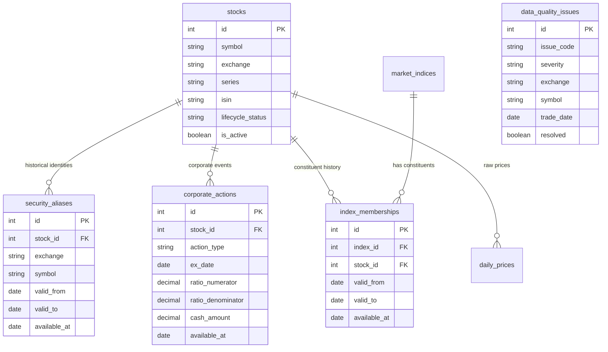

# Historical Data Architecture — Sprint 19.1C

## Architectural Principles & Guiding Mandates

### 1. Separation of Concerns
- **Data Storage** is decoupled from **Scanner Universe Eligibility**.
- Daily prices (`DailyPrice`), corporate actions (`CorporateAction`), index memberships (`IndexMembership`), and security identity aliases (`SecurityAlias`) record historical facts as they occurred.
- Scanners and backtest replay engines query these facts through point-in-time filtered interfaces without modifying raw storage rows.

### 2. Immutability of Raw Prices
- `DailyPrice` rows are raw source facts. OHLCV, volume, and delivery quantities are **never mutated** or overwritten to apply splits or bonuses.
- Backward-adjusted price series are computed deterministically on demand by `PriceAdjustmentService` and returned as `AdjustedPrice` dataclass instances.

### 3. Point-in-Time Integrity (`available_at` Semantics)
- Every historical identity record, corporate action, and index membership carries an `available_at` date column representing when that fact became knowable to an observer.
- All historical query interfaces accept an `as_of_date` parameter ($T$) and strictly enforce `available_at <= T`.
- **Timestamp Semantics**: The API intentionally accepts date-only values for EOD research. The `available_at: date` cutoff represents the end of the calendar day (23:59:59 IST). While intraday leakage is technically possible if running evaluations mid-day against same-day announcements, this is acceptable as the system is strictly an End-of-Day historical research platform.

### 4. Idempotency and Duplicates
- **Corporate Actions**: The database constraint on `(stock_id, action_type, ex_date)` was removed to natively allow legitimate distinct actions occurring on the same day (e.g. regular vs special dividends). Deduplication or aggregation must be handled by the import/application logic.
- No look-ahead bias: announcements published after $T$ are invisible to queries evaluated at $T$.

### 5. Data Quality Explicit Reporting ("MISSING != ZERO")
- Incomplete, anomalous, or suspicious data is recorded as `DataQualityIssue` entries with typed issue codes (`OHLC_INVALID`, `NEGATIVE_VOLUME`, `ZERO_VOLUME`, `IDENTITY_AMBIGUOUS`, etc.).
- Data issues are **never silently repaired** or replaced with zero values. Missing data stays `None`.

---

## Domain Model Extensions

### Table Specifications

#### 1. `security_aliases`
Records historical exchange symbols for a `Stock` entity. Enables point-in-time symbol resolution (`OLDABC` $\rightarrow$ `Stock.id=42` on date $T$).
- **UniqueConstraint**: `(exchange, symbol, valid_from)`
- **CheckConstraint**: `valid_to IS NULL OR valid_to >= valid_from`

#### 2. `corporate_actions`
Idempotent storage for splits, bonuses, dividends, etc.
- **UniqueConstraint**: `(stock_id, action_type, ex_date)`
- **CheckConstraint**: `action_type IN ('split','bonus','dividend','rights','merger','demerger','buyback','symbol_change','name_change')`
- **CheckConstraint**: `ratio_numerator > 0`, `ratio_denominator > 0`

#### 3. `index_memberships`
Constituent history for market indices (`market_indices.id`).
- **UniqueConstraint**: `(index_id, stock_id, valid_from)`
- **CheckConstraint**: `valid_to IS NULL OR valid_to >= valid_from`
- **CheckConstraint**: `weight IS NULL OR (weight >= 0 AND weight <= 100)`

#### 4. `data_quality_issues`
Non-mutating registry of detected data quality problems.
- **CheckConstraint**: `severity IN ('warning', 'error')`

#### 5. `stocks` (Extended Column)
- `lifecycle_status`: `active`, `suspended`, `delisted`, `inactive`, `unknown`. Default `"active"`.

---

## Price Adjustment Methodology

### Pure Service Computation
- Class: `PriceAdjustmentService` (`app/services/price_adjustment.py`)
- Standard backward adjustment convention for prices strictly before `ex_date`:
  - **Split** ($N:M$, e.g. 1:2 split): $\text{factor} = M / N = 2.0$. $\text{price}_{\text{adj}} = \text{price}_{\text{raw}} / 2.0$.
  - **Bonus** ($N:M$, e.g. 1:2 bonus): $\text{factor} = (M + N) / M = 1.5$. $\text{price}_{\text{adj}} = \text{price}_{\text{raw}} / 1.5$.
- **Deferred adjustment types**: Dividends, rights, mergers, and demergers are stored as facts but price adjustments are deferred pending total-return methodology selection.

---

## Historical Service & Coverage Layer

- **`HistoricalQueryService`** (`app/services/historical_query.py`): Point-in-time research service providing `resolve_symbol_as_of()`, `get_price_history()`, `get_adjusted_price_history()`, `get_corporate_actions()`, `get_index_members()`, `get_universe_as_of()`, and `get_data_quality_issues()`.
- **`HistoricalCoverageService`**: Provides coverage metrics for corporate actions, index memberships, data quality summaries, and date-range price coverage.

---

## Database Migration

- Single revision: `ac9c6a6767be_add_historical_data_core_tables.py`
- Parent revision: `95a0be65d4a7`
- Head: `ac9c6a6767be (head)`
